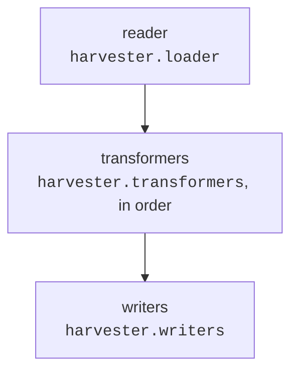

# Readers, transformers and writers

A harvest is an invenio-vocabularies *datastream* built from the harvester definition
(see [tasks][oarepo_oaipmh_harvester.tasks]):



The defaults cover a plain OAI-PMH source whose metadata format the target model can
import:

- **reader** - invenio's `oai-pmh` reader;
- **transformer** - [`oai-import`][oarepo_oaipmh_harvester.transformers.oai_import], which
  converts the metadata with one of the model's imports;
- **writer** - [`oai-service`][oarepo_oaipmh_harvester.writers.oai_service], which
  creates, updates and deletes the local records and keeps a *harvest record* for every
  harvested OAI identifier.

A source that is not an OAI-PMH endpoint (e.g. a JSON API) needs a custom reader;
metadata the model can not import, or data that need adjusting, need a custom
transformer; additional actions with the harvested records need a custom writer. This
page describes what each of them receives, what it has to produce and how errors are
handled.

## Registration and options

Readers, transformers and writers are looked up by name in the
`VOCABULARIES_DATASTREAM_READERS` / `_TRANSFORMERS` / `_WRITERS` config (name → class).
The `oai-import` transformer and the `oai-service` writer are added by this library;
register your own in `invenio.cfg`:

```python
from invenio_vocabularies.config import (
    VOCABULARIES_DATASTREAM_READERS as _READERS,
    VOCABULARIES_DATASTREAM_TRANSFORMERS as _TRANSFORMERS,
    VOCABULARIES_DATASTREAM_WRITERS as _WRITERS,
)

from my_repository.oai import DoiToIdTransformer, MyApiReader, MyApiTransformer, NotifyWriter

VOCABULARIES_DATASTREAM_READERS = {**_READERS, "my-api": MyApiReader}
VOCABULARIES_DATASTREAM_TRANSFORMERS = {
    **_TRANSFORMERS,
    "my-api": MyApiTransformer,
    "doi-to-id": DoiToIdTransformer,
}
VOCABULARIES_DATASTREAM_WRITERS = {**_WRITERS, "notify": NotifyWriter}
```

With `oarepo-config`, `config.configure_datastreams(readers=..., transformers=...,
writers=...)` does the same and also accepts import strings
(`"my_repository.oai:MyApiReader"`).

The harvester refers to them as `name{options}`, the options being a JSON5 object - for
example in the `oai_harvesters.yaml` fixture:

```yaml
- id: my-source
  name: My source
  base-url: https://api.example.org
  metadata-prefix: json
  loader: my-api{page_size:100}
  transformer:
    - my-api
    - doi-to-id{prefix:"ext-"}
  writer:
    - oai-service{model:"datasets"}
    - notify{url:"https://example.org/hooks/harvest"}
```

Each class is instantiated for every harvest, with the options as keyword arguments,
plus:

- `harvester_id` - always, for every reader, transformer and writer;
- for the reader, unless set in the options: `base_url`, `metadata_prefix`, `set` (the
  harvester's `setspec`), `from_date` (incremental harvests - only records changed since
  then) and `identifiers` (re-harvest of the given records only).

Accept `**kwargs`, so that options added in the future do not break your class.

!!! note
    invenio reports any `KeyError` raised in the constructor as
    `FactoryError: Transformer <name> not configured` (or `Reader` / `Writer`). If you
    get it for a name you have registered, check the constructor.

## Readers

A reader subclasses `invenio_vocabularies.datastreams.readers.BaseReader` and implements
`read(item=None, *args, **kwargs)`, a generator yielding one item per harvested record.
The item is an *OAI record* - any object with these attributes:

| Attribute | Meaning |
|---|---|
| `header.identifier` | unique identifier of the record at the source - the key of its harvest record |
| `header.datestamp` | last change at the source, an ISO 8601 string or a `datetime` (UTC when without timezone); a record with an unchanged datestamp is skipped |
| `header.deleted` | `True` if the record was deleted at the source - the local record gets deleted |
| `raw` | the original payload as a string, stored on the harvest record |

It may be yielded as is or as `{"record": <OAI record>}`, as invenio's `oai-pmh` reader
does (with an `oaipmh_scythe` `Record`).

Honour `from_date` - otherwise every scheduled harvest reads the whole source - and
`identifiers`, used to re-harvest selected records from the administration or the
`invenio oai harvest <harvester> <identifiers>` command.

!!! warning "Errors in readers stop the harvest"
    An exception raised by a reader ends the harvest: there is no record to attach it to
    yet, and a generator can not continue after raising. Keep readers simple - fetch,
    wrap into an OAI record and yield - and do any parsing or conversion of the payload
    in a transformer, where a failure affects only that record. Let network errors
    propagate: the harvest fails and the next run picks the records up again (scheduled
    runs harvest from the last successful run).

Example - a reader of a paginated JSON API:

```python
import dataclasses
import json

import requests
from invenio_vocabularies.datastreams.readers import BaseReader


@dataclasses.dataclass
class Header:
    identifier: str
    datestamp: str
    deleted: bool = False


@dataclasses.dataclass
class ApiRecord:
    header: Header
    raw: str
    json: dict


class MyApiReader(BaseReader):
    def __init__(self, *args, base_url=None, from_date=None, identifiers=None, page_size=50, **kwargs):
        super().__init__(origin=base_url)
        self.from_date = from_date
        self.identifiers = set(identifiers or [])
        self.page_size = page_size

    def read(self, item=None, *args, **kwargs):
        url = f"{self._origin}/records"
        params = {"size": self.page_size}
        if self.from_date:
            params["updated_since"] = self.from_date
        while url:
            response = requests.get(url, params=params, timeout=60)
            response.raise_for_status()  # stops the harvest, the next run tries again
            body = response.json()
            for hit in body["hits"]:
                identifier = f"oai:my-api:{hit['id']}"
                if self.identifiers and identifier not in self.identifiers:
                    continue
                yield ApiRecord(
                    header=Header(identifier=identifier, datestamp=hit["updated"], deleted=hit.get("deleted", False)),
                    raw=json.dumps(hit),
                    json=hit,
                )
            url, params = body["links"].get("next"), None
```

## Transformers

A transformer subclasses `invenio_vocabularies.datastreams.transformers.BaseTransformer`
and implements `apply(stream_entry, *args, **kwargs)`. It gets a `StreamEntry` and
**returns** it - the returned entry goes to the next transformer. `stream_entry.entry` is
the reader's item for the first transformer and the previous transformer's output for
the others.

After the last transformer, the entry must be:

```python
{
    "record": {...},  # data for the model's service (create / update), None if deleted at the source
    "oai_record": oai_record,  # the reader's OAI record, unchanged
}
```

`record` is what you would send to the model's REST API. The `oai-service` writer also
understands:

- **the record's pid** - for models whose pid provider reads the pid from the record data
  (`get_pid_value_from_record`, e.g. external pids in `id`), a record harvested for the
  first time takes over the local record with the same pid instead of creating a new one;
- **`parent.communities.ids`** - slugs or ids of communities to add the record to, see
  [Communities](#communities);
- **no `files` / `media_files`** - the sections are written as `{"enabled": False}`.

A record deleted at the source (`header.deleted`) has no metadata: produce
`"record": None`, and let the following transformers pass such entries through.

### Using `oai-import`

[`oai-import{model:"<model>"}`][oarepo_oaipmh_harvester.transformers.oai_import] takes the
element inside the OAI `<metadata>` and converts it with the model's import whose
`oai_name` is the element's `(namespace, local name)`. For example, a model that can
import DataCite XML, harvested with the `oai_datacite` metadata prefix:

```python
from oarepo_model.customizations import AddMetadataImport

AddMetadataImport(
    code="datacite-xml",
    name=_("DataCite XML"),
    mimetype="application/vnd.datacite.datacite+xml",
    deserializer=DataCiteXMLDeserializer(),
    oai_name=("http://datacite.org/schema/kernel-4", "resource"),  # (namespace, local name)
)
```

```yaml
metadata-prefix: oai_datacite
transformer:
  - oai-import{model:"datasets"}
```

The deserializer gets the XML element (`deserialize_xml`) if it has that method, the
element serialized to a string (`deserialize`) otherwise, and returns the record data.
If it raises - e.g. a marshmallow `ValidationError` for data it can not convert - the
record fails, see [Errors](#errors). Add further transformers after `oai-import` to
adjust its output.

### Example

Converting the `MyApiReader` records above, and a second transformer taking the
record's pid from its DOI:

```python
from invenio_vocabularies.datastreams.errors import TransformerError
from invenio_vocabularies.datastreams.transformers import BaseTransformer


class MyApiTransformer(BaseTransformer):
    def __init__(self, *args, **kwargs):
        pass

    def apply(self, stream_entry, *args, **kwargs):
        oai_record = stream_entry.entry
        if oai_record.header.deleted:
            stream_entry.entry = {"record": None, "oai_record": oai_record}
            return stream_entry
        hit = oai_record.json
        stream_entry.entry = {
            "record": {
                "metadata": {"title": hit["title"], "publication_date": hit["published"]},
                "parent": {"communities": {"ids": [hit["department"]]}},
            },
            "oai_record": oai_record,
        }
        return stream_entry


class DoiToIdTransformer(BaseTransformer):
    def __init__(self, *args, prefix="", **kwargs):
        self.prefix = prefix

    def apply(self, stream_entry, *args, **kwargs):
        record = stream_entry.entry["record"]
        if record is None:  # deleted at the source
            return stream_entry
        dois = [i["identifier"] for i in record["metadata"].get("identifiers", []) if i["scheme"] == "doi"]
        if not dois:
            raise TransformerError("The record has no DOI, can not create its identifier.")
        record["id"] = self.prefix + dois[0]
        return stream_entry
```

## The `oai-service` writer

[`oai-service{model:"<model>", ...}`][oarepo_oaipmh_harvester.writers.oai_service.OAIServiceWriter]
brings the local record to the state reported by the source - creates, updates, deletes,
restores - through the model's service, and stores the harvest record. Its options and
the rules it follows are described in the
[module documentation][oarepo_oaipmh_harvester.writers.oai_service]. For example, a
writer adding every record to the `cesnet` community and updating published records
without a draft round trip:

```yaml
writer:
  - oai-service{model:"datasets", community:"cesnet", direct_update:true}
```

### Communities

Written records are added to the writer's `community` and to the communities listed in
the record's `parent.communities.ids`, so a transformer can decide the membership per
record. They are added directly (RDM `bulk_add`), without a community inclusion request;
a subcommunity's parent is added as well, and the community becomes the default one if
the record has none yet. Communities the record is already in are skipped, and records
are never removed from a community. An unknown community makes the record fail.

### The harvest record

Every harvested OAI identifier has a harvest record
([OAIHarvestedRecord][oarepo_oaipmh_harvester.oai_record.models.OAIHarvestedRecord],
*Administration → OAI-PMH Harvester Records*):

| Field | Content |
|---|---|
| `oai_identifier` | `oai_record.header.identifier` |
| `harvester_id` | the harvester that harvested the record |
| `datestamp` | `oai_record.header.datestamp`, in UTC |
| `deleted` | `oai_record.header.deleted` |
| `harvested_at` | when the record was processed |
| `original_data` | `{"oai_payload": oai_record.raw}` - the payload as received |
| `transformed_data` | `record` as produced by the transformers (values that are not JSON as strings); empty if the record failed in a transformer or was deleted at the source |
| `record_pid`, `record_type` | pid and model of the local record; kept from the previous harvest when writing fails |
| `errors` | list of `{"type", "location", "message"}`, see below |
| `has_errors` | `errors` is not empty |
| `has_warnings` | always `False` - warnings are not tracked |

`errors` contain:

- validation errors reported by the model's service - `type` is `validation_error`,
  `location` the field and `message` the message;
- exceptions raised by a transformer or while writing - `type` is the exception class,
  `message` its text and `location` a trimmed traceback with the local variables of each
  frame;
- errors reported by the datastream as strings - only `message`.

A record with `has_errors` is written again by the next harvest even if its datestamp did
not change. A record without errors whose datestamp did not change is skipped, unless
the writer has `update_all`.

## Custom writers

To do something more with the harvested records - notify another system, collect
statistics - add a writer *after* `oai-service` (see the fixture above). A writer
subclasses `invenio_vocabularies.datastreams.writers.BaseWriter` and implements
`write(stream_entry, *args, **kwargs)` and `write_many(stream_entries, *args, **kwargs)`.

- All writers get the **same** entry object and the datastream ignores what they
  return - change the entry in place if a later writer should see it.
- After `oai-service`, `stream_entry.entry["record"]` is the local record as returned by
  the service (`None` if it was deleted or nothing was written) and
  `stream_entry.op_type` the
  [Operation][oarepo_oaipmh_harvester.writers.oai_service.Operation] performed. A record
  skipped as up to date has `op_type` `None` and `record` set to the current local
  record.
- Check `stream_entry.errors` / `stream_entry.exc` first - a record that failed in a
  transformer or in `oai-service` has them set and was not written.
- An exception raised by a writer does not stop the harvest (see [Errors](#errors)), but
  it is **not** stored on the harvest record - `oai-service` has committed that (and the
  local record) already. Make the writer tolerate failures of its own target.

Example - notifying another system about written records:

```python
import requests
from flask import current_app
from invenio_vocabularies.datastreams.writers import BaseWriter


class NotifyWriter(BaseWriter):
    def __init__(self, *args, url, **kwargs):
        super().__init__()
        self.url = url

    def write(self, stream_entry, *args, **kwargs):
        if stream_entry.errors or stream_entry.exc is not None or stream_entry.op_type is None:
            return stream_entry  # failed, or unchanged since the last harvest
        record = stream_entry.entry["record"]
        try:
            requests.post(
                self.url,
                json={"operation": str(stream_entry.op_type), "id": record["id"] if record else None},
                timeout=10,
            )
        except requests.RequestException:
            current_app.logger.warning("Could not notify %s", self.url, exc_info=True)
        return stream_entry

    def write_many(self, stream_entries, *args, **kwargs):
        return [self.write(stream_entry) for stream_entry in stream_entries]
```

A writer *replacing* `oai-service` has to keep the harvest records itself - incremental
harvests, deletions and the administration of harvested records depend on them.
Subclass [OAIServiceWriter][oarepo_oaipmh_harvester.writers.oai_service.OAIServiceWriter]
instead and override what needs to be different.

## Errors

A single record never stops the harvest - transformers and writers are wrapped by
[create_datastream][oarepo_oaipmh_harvester.datastream.create_datastream]. Only reader
errors (see [Readers](#readers)) and configuration errors (an unknown reader, transformer
or writer name) end it.

A transformer signals that a record can not be imported by **raising** - preferably a
`TransformerError` with a message that tells the repository manager what is wrong, but
any exception (a `KeyError` on unexpected data, a marshmallow `ValidationError`, ...) is
handled the same way. Appending messages to `stream_entry.errors` and returning the entry
works too; they are reported as one `TransformerError`. Then:

- the following transformers are skipped and the record is not written - the local
  record, if any, stays as it is;
- the harvest record gets `has_errors` and the error (type, message, traceback with
  local variables); its `transformed_data` is empty;
- the harvest logs `Entry <identifier>: failed: <type>: <message>` and goes on with the
  next record;
- the next harvest processes the record again, even if its datestamp did not change.

Errors while writing - validation errors reported by the model's service, exceptions in
the service, an unknown community - are handled by `oai-service` the same way: the whole
write is rolled back, the errors are stored on the harvest record, the writer logs
`OAI identifier <identifier>: <n> error(s) stored on the harvest record: ...` and the
harvest logs the record as failed.

There are no warnings - a record is either written or fails. If a problem should not
prevent the import, fix the data in the transformer (and log it) instead.
